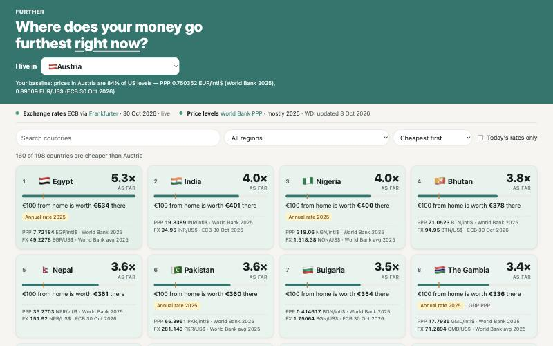
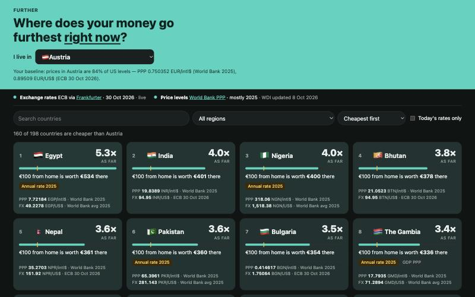
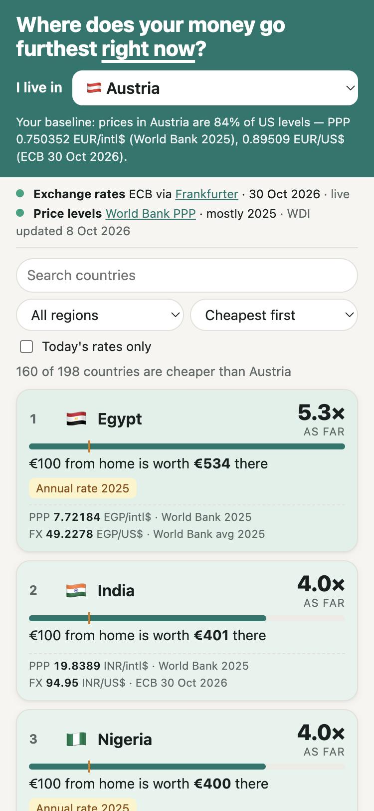

# Further

Pick your home country and see every country ranked by how far your money goes there **right now**:
World Bank PPP price levels combined with today's ECB exchange rates (via Frankfurter).

Static site, no backend, no build step. Plain ES modules, relative paths and a bundled data snapshot, so it can become a PWA by adding a manifest and service worker.

| Desktop | Dark mode | Mobile |
|---|---|---|
|  |  |  |

## Run it locally

The app is plain files: no install or build step. It must be served over `http://`. Double-clicking `index.html` opens it as a `file://` page, which Chrome and Safari block (they refuse to load the app's scripts and data from disk).

**1. Open a terminal in this folder** (the one containing `index.html`):

```bash
cd ~/Claude/Workspace/further
```

**2. Start a local web server.** Pick whichever you have installed:

- Python 3 (preinstalled on macOS):
  ```bash
  python3 -m http.server 8765
  ```
- Node.js:
  ```bash
  npx --yes serve -l 8765
  ```

**3. Open <http://localhost:8765>** in any browser.

Optionally add `?home=` and a three-letter country code to the URL to preselect a home country, e.g. <http://localhost:8765/?home=AUT>. Otherwise the app picks one from your browser language and remembers your choice.

**4. Stop the server** with `Ctrl+C` in the terminal.

The workspace's `.claude/launch.json` also has a `further` entry, so the Claude desktop app can start it in its preview pane.

### What you should see

The country list appears straight away using the bundled exchange rates. Then today's ECB rates are fetched, and the line under the header changes to **"… · live"**.

If it says **"offline, bundled snapshot"** or **"offline, last fetched copy"**, today's rates couldn't be loaded. This happens with no network, a blocked `api.frankfurter.dev`, or no response within 8 seconds. Everything still works, using the rates from the date shown. Exchange rates are cached in the browser after each successful fetch.

### Publish it

Any static host works (GitHub Pages, Netlify, Cloudflare Pages, a plain web server). Upload the folder as it is.

When someone opens the site, their browser only loads `index.html`, `src/` and `data/`. The other folders are for you, not the browser:

- `scripts/` contains Node.js tools you run on your own computer to refresh and check the data. A browser can't run them, and nothing on the page links to them.
- `docs/` holds the screenshots shown in this README.

So you *can* leave them out of an upload and the site works the same. On GitHub, keep them in the repository: the automatic data refresh below runs `scripts/` on GitHub's servers.

### GitHub Pages with automatic data refresh

Exchange rates are always fresh, because each visitor's browser fetches them. The World Bank figures are a snapshot in `data/`. The workflow in `.github/workflows/refresh-and-deploy.yml` keeps that snapshot up to date and publishes the site.

**Setup (once).** This assumes this folder is the root of the repository:

1. Push the repository to GitHub with `main` as the default branch.
2. In the repository, go to **Settings → Pages → Build and deployment → Source** and choose **GitHub Actions**.
3. Go to **Actions → Refresh data and deploy → Run workflow** for the first deploy. The site address appears in the run summary and under Settings → Pages.

**What it does.** It runs every Monday at 06:17 UTC, on every push to `main`, and whenever you start it by hand. Each run:

1. downloads the latest World Bank figures and ECB rates (`scripts/build-data.mjs`),
2. checks every figure against the World Bank (`scripts/verify.mjs`),
3. commits the refreshed `data/` folder back to `main` if anything changed (weekly and manual runs only, so your own pushes don't get a bot commit on top),
4. publishes `index.html`, `src/` and `data/` to GitHub Pages.

**If a step fails** (an API is down, a currency mapping looks wrong, or a figure is out of tolerance), the run stops before steps 3 and 4. The live site keeps its last good data, and GitHub emails you about the failed run. Also, GitHub pauses scheduled workflows in public repositories that have had no activity for 60 days. It warns you by email first, and one click in the Actions tab turns the workflow back on.

## Refresh and check the data by hand

The GitHub workflow does this for you. To do it locally you need Node.js 18 or newer. Run from this folder:

```bash
node scripts/build-data.mjs
```

This downloads the latest World Bank figures and today's ECB rates into `data/countries.json` and `data/fx-snapshot.json`. It stops with an error if a currency mapping looks wrong.

```bash
node scripts/verify.mjs
```

This checks every figure against the live World Bank API (see Tolerance below). It exits with code 1 if anything is outside tolerance.

- **PPP:** household final consumption PPP `PA.NUS.PRVT.PP`. GDP PPP `PA.NUS.PPP` is used when it is more recent; the card says so.
- **Exchange rate:** today's ECB rate where the ECB quotes the currency, or where it is fixed to one it quotes (euro conversion rates, CFA/CFP francs, Gulf pegs, rand/rupee pegs: see `scripts/currencies.mjs`). Otherwise the World Bank annual average (`PA.NUS.FCRF`) for the PPP year, labelled "Annual rate".
- **Excluded countries:** see [Countries not ranked](#countries-not-ranked) below. The build fails if a mapped peg is more than 40% off the World Bank average, to catch mapping errors.
- **Data quirks handled:** Bulgaria's 2025 figures are still in leva, so they are converted at the fixed euro rate of 1.95583. Liberia's PPP is published in USD, while its exchange rate series is in Liberian dollars.

## Countries not ranked

A country's price level is its PPP factor divided by an exchange rate, and the two must describe the same moment. When they don't, the result can be wildly wrong, so the country is left out rather than shown with a misleading figure. The rules are in [compute.js](src/compute.js):

1. **No PPP data.** The World Bank publishes no PPP factor for the country.
2. **No usable exchange rate.** The ECB doesn't quote the currency, and the World Bank has no annual rate since 2005.
3. **Exchange rate from the wrong year.** The ECB doesn't quote the currency, and the World Bank's latest annual rate is more than one year older than the PPP figure. In high-inflation economies, prices and exchange rates move a lot within a year or two. Dividing 2025 prices by a 2020 rate makes a country look far more expensive or cheaper than it is.
4. **Implausible result.** The price level comes out below 0.12× or above 3× the US level. Every real country falls well inside that range, so a result outside it means a broken series. Examples are a currency redenomination, or an official rate far from the rate people actually pay.

The current list, from the World Bank data updated 8 Oct 2026, is below. It changes whenever `scripts/build-data.mjs` is rerun. The app always shows the live list, with reasons, under "countries not ranked — why?" at the bottom of the page.

| Country | Rule | Detail |
|---|---|---|
| Channel Islands, Gibraltar, Isle of Man, Liechtenstein, Monaco, Saint Martin, North Korea | 1 | No World Bank PPP figure |
| Cuba | 2 | Latest official rate is from 1974 (PPP is from 2011) |
| Turkmenistan | 2 | Latest official rate is from 2001 (PPP is from 2025) |
| Afghanistan | 3 | PPP 2024, exchange rate 2020 |
| Guinea | 3 | PPP 2025, exchange rate 2020 |
| Iran | 3 | PPP 2025, exchange rate 2023. The rate is also the official 42,000 rial rate, far from what people actually pay. Combined, they would put Iran at 3.8× US prices. |
| Malawi | 3 | PPP 2025, exchange rate 2023 |
| Mauritania | 3 | PPP 2025, exchange rate 2023 |
| Myanmar | 3 | PPP 2025, exchange rate 2020 |
| Sierra Leone | 3 | PPP 2025, exchange rate 2023 (the leone was redenominated in 2022) |
| Somalia | 3 | PPP 2025, exchange rate 2017 |
| Sudan | 3 | PPP 2025, exchange rate 2022 |
| Venezuela | 4 | Latest data is 2011, in pre-redenomination bolívars, so the price level comes out as 0.00× US |

## Tolerance

| Figure | Check | Tolerance | Latest result |
|---|---|---|---|
| PPP factor (snapshot and displayed, 6 significant digits) | equals the live World Bank API value for the same indicator and year | ±0.01% | 210 countries, worst 0.00045% |
| Price level (PPP ÷ FX) | recomputed from raw API values and ECB rates | ±0.1% | 198 countries, worst 0.00000% |
| Source and date | present for every PPP and FX figure on every card | — | 198/198 |

The same check was also run on the rendered page: it parsed every card's PPP value and compared it with the live API. All 198 matched (worst deviation 0.00045%). A deliberately injected 0.1% error makes `verify.mjs` exit 1.

## Compared with Nomads.com (`/countries`, sorted by cost)

Compared on 30 Oct 2026, at 375px and 1280px wide.

| | Nomads.com | Further |
|---|---|---|
| First result on mobile (375px) | ~1,100px down, after the hero and sign-up box | 389px |
| Results on a 1280px screen | 6 photo cards plus ads | 8 cards, no ads |
| Relative to you | no — absolute $/month for a nomad | yes — "€100 from home is worth €534 there" for your country |
| Source / date of figures | not shown | on every card, plus the formula and links |
| Unreliable data | Iran ranked #1 | Iran excluded, with the reason shown |
| Visual appeal | photos, weather, internet speed | text cards tinted by value; no imagery |
| Absolute budget | $/month | not shown (PPP gives relative prices only) |

## Caveats

- PPP describes the PPP year. If a currency has fallen since then, local prices have usually risen, so that country looks cheaper than it is. Cards flag a move of 10% or more.
- Figures are national averages.
